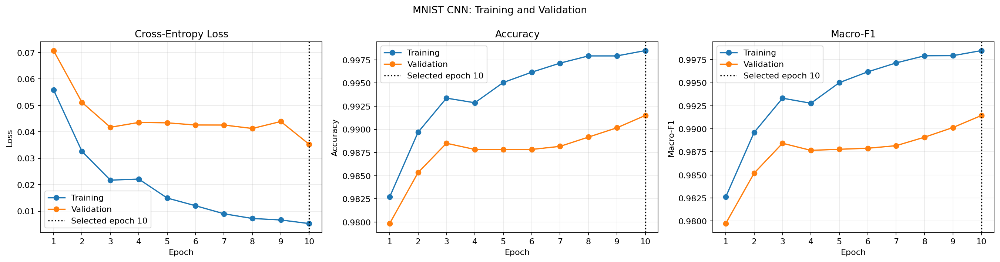
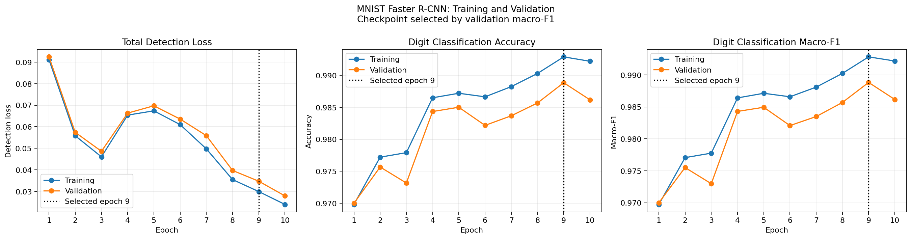
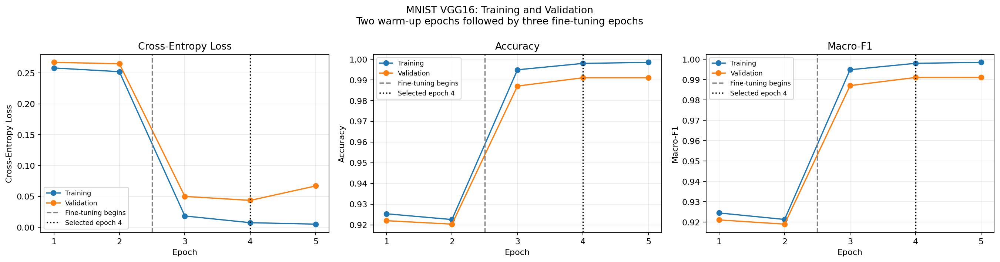
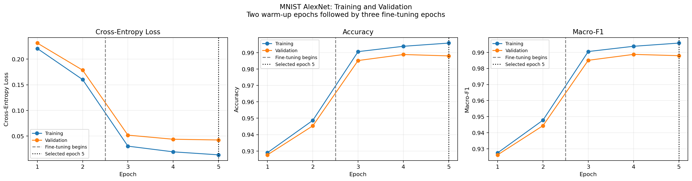
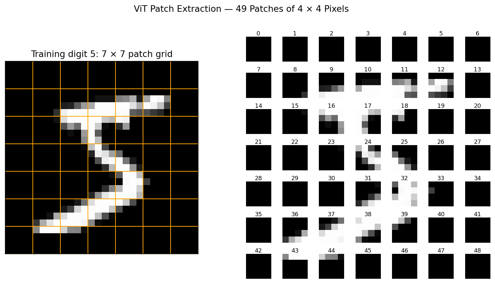
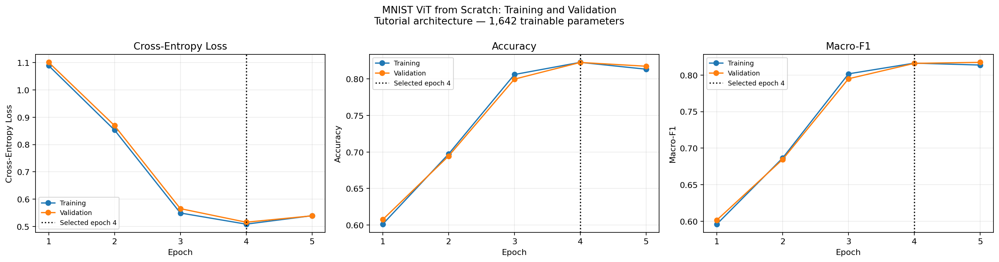
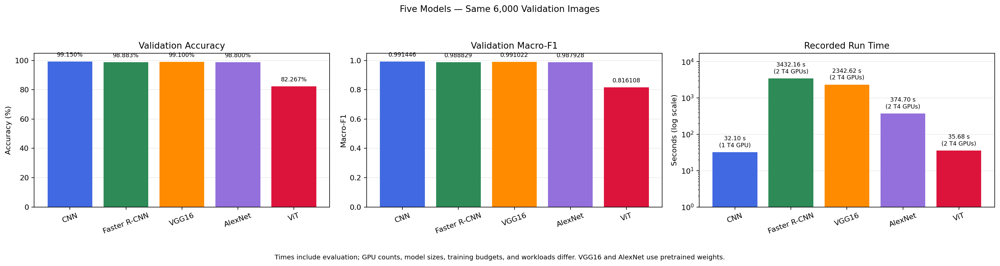
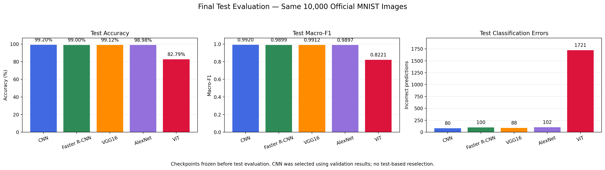
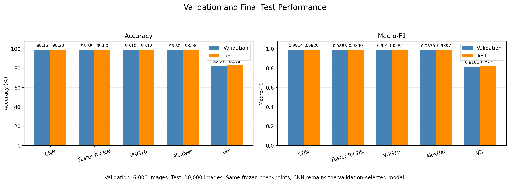

# Deep Learning Lab 2

Classifying MNIST digits with PyTorch on GPU using a CNN, Faster R-CNN, pretrained VGG16 and AlexNet, and a Vision Transformer built from scratch.

All experiments run in Kaggle. The repository stores notebooks and selected figures; raw datasets, model checkpoints, and detailed local report exports are excluded.

## Notebooks

| Notebook | Purpose |
| --- | --- |
| [CNN](notebooks/01_cnn_mnist.ipynb) | Convolution, pooling, and fully connected layers |
| [Faster R-CNN](notebooks/02_faster_rcnn_mnist.ipynb) | Detection adaptation and comparison with the CNN |
| [VGG16](notebooks/03_vgg16_mnist.ipynb) | Fine-tuning pretrained VGG16 |
| [AlexNet](notebooks/04_alexnet_mnist.ipynb) | Fine-tuning pretrained AlexNet |
| [Vision Transformer](notebooks/05_vit_mnist.ipynb) | ViT implementation and training from scratch |

## Run in Kaggle

1. Import the notebook for the model you want to run from this repository.
2. Attach the [MNIST dataset specified in the assignment](https://www.kaggle.com/datasets/hojjatk/mnist-dataset) and enable a GPU.
3. Execute the setup cells in order and review their outputs before starting model training.
4. Download the executed notebook to the matching local `notebooks/` path. Copy selected figures from `/kaggle/working/plots/` to `assets/plots/`. Keep detailed exports from `/kaggle/working/results/` in local, Git-ignored `reports/`.

The final evaluation is in the ViT notebook. Attach the five saved checkpoints and their result exports to run that section without retraining.

The notebooks record installed package versions and GPU information. Their setup cells share the same split procedure and print a split hash that must match across experiments.

## Data and comparison protocol

The Kaggle setup verified 60,000 official training images and 10,000 test images, each measuring 28 by 28 pixels. A stratified split with seed 42 reserves 6,000 training images for validation. All five executed notebooks use the same 54,000 training, 6,000 validation, and 10,000 test image partitions. The matching split hash confirms identical source indices.

The setup also verified CUDA execution, finite gradients, valid labels, and coverage of all ten digits. Training class counts range from 4,879 to 6,068, so no resampling was applied. The environment used Python 3.13.15, PyTorch 2.11.0+cu128, torchvision 0.26.0+cu128, and Tesla T4 GPUs.

Model and checkpoint choices use validation only. The final test comparison is performed after all configurations are frozen. We report accuracy, macro-F1 across ten digits, loss, and training time. GPU, epochs, batch size, transformations, and pretrained initialization are documented for each experiment.

For Faster R-CNN, the proposed adaptation assigns one full-image box to each digit. Detector label 0 is reserved for background. The highest-scoring detection provides the digit prediction; missing detections count as errors. These boxes are derived annotations, not localization labels supplied by MNIST. Detection loss is reported separately from classifier cross-entropy because their objectives differ.

VGG16 and AlexNet use pretrained weights and model-specific input transforms. The CNN and ViT are trained from scratch. Training time includes per-epoch validation and excludes downloads, with CUDA synchronization around timing.

## Experiments and validation results

### CNN

The CNN uses two convolution blocks with 32 and 64 channels. Each block uses a 3-by-3 kernel, stride 1, padding 1, ReLU, and 2-by-2 max pooling. A 128-unit fully connected layer, ReLU, dropout of 0.25, and a ten-logit output form the classifier. The model has 421,642 trainable parameters and was trained from scratch with Adam, learning rate 0.001, batch size 64, and unweighted cross-entropy for ten epochs.

Epoch 10 was selected by the lowest validation loss. It achieved 99.15% validation accuracy and 0.991446 macro-F1, with 51 errors among 6,000 images. Training accuracy was 99.85%, a gap of 0.70 percentage points. Every digit achieved an F1 score above 0.98; digits 8 and 9 had the lowest F1 scores.

Validation loss fluctuated after the first few epochs but reached its minimum at epoch 10. The selected checkpoint was later evaluated on the official test set, as reported below.

### Faster R-CNN

The full detector uses a small custom backbone trained from scratch, a region proposal network, RoI pooling, and classification and box-regression heads. It has 484,388 trainable parameters. Ten epochs of Adam training used learning rate 0.001 and a global batch size of 32, split across two T4 GPUs with DistributedDataParallel. Digit labels 0-9 map to detector labels 1-10; background occupies label 0. Inference retains the highest-scoring detection with a fixed score threshold of 0.0.

Epoch 9 was selected by the highest validation macro-F1. Its restored weights independently reproduced 98.8833% validation accuracy and 0.988829 macro-F1, with 67 errors and no missing detections. Digit 9 had the lowest recall, followed by digit 3. The derived full-image boxes adapt the detector to digit classification; they do not establish performance on a genuine localization task.

Epoch 10 had a lower detection loss but lower validation macro-F1. Detection loss combines several objectives, so it need not decrease in step with classification errors.

### VGG16

VGG16 starts with ImageNet-pretrained weights and a new ten-class output layer. Each grayscale image is repeated across three channels, resized to 256 by 256, centrally cropped to 224 by 224, and normalized using the pretrained weights' ImageNet statistics. The adapted model contains 134,301,514 parameters.

Two warm-up epochs trained only the new output layer using Adam with learning rate 0.001. Three fine-tuning epochs then updated convolution block 5 at learning rate 0.00001 and the classifier at 0.0001. Convolution blocks 1–4 remained frozen. Training used float32 and a global batch size of 32 across two T4 GPUs.

Fine-tuning raised validation accuracy from about 92% to 99.10%. Epoch 4 had the lowest validation cross-entropy, so its checkpoint was retained. Its restored predictions independently reproduced 0.991022 macro-F1 and 54 errors among 6,000 images. Digit 9 had the lowest recall, at 97.14%; every digit achieved an F1 score above 0.98.

At epoch 5, training loss continued to decrease while validation loss increased from 0.043520 to about 0.0669, with validation accuracy still at 99.10%. This suggests increasing overfitting and supports retaining epoch 4. The full five-epoch run took 39.04 minutes, including per-epoch evaluation and checkpoint writes.

### AlexNet

AlexNet starts with ImageNet-pretrained weights and a new ten-class output layer. It uses the same three-channel conversion, resize to 256, center crop to 224, and ImageNet normalization as VGG16. The adapted model has 57,044,810 parameters.

Two warm-up epochs trained only the output layer using Adam with learning rate 0.001. Three fine-tuning epochs updated the last convolution layer at learning rate 0.00001 and the classifier at 0.0001. Earlier convolution layers remained frozen. Training used float32 and a global batch size of 32 across two T4 GPUs.

Epoch 5 was selected by the lowest validation cross-entropy, even though epoch 4 had slightly higher accuracy. Its restored checkpoint independently reproduced 98.80% accuracy, 0.987928 macro-F1, and 72 errors on the 6,000 validation images. Digit 8 had the lowest recall (97.44%), while digit 9 had the lowest F1 score (0.9808). The largest individual confusion was digit 4 predicted as 9, with nine examples.

Fine-tuning raised validation accuracy from 94.53% after warm-up to 98.80% at the selected checkpoint. The complete five-epoch run took 6.25 minutes, including per-epoch evaluation and checkpoint writes.

### Vision Transformer from scratch

The ViT follows Brian Pulfer's tutorial: 49 patches of 4 by 4 pixels, eight-dimensional embeddings, a learnable classification token, fixed sinusoidal positional encoding, and two transformer blocks with two attention heads. Each block uses layer normalization, residual connections, and an MLP expanding from 8 to 32 dimensions. The model has only 1,642 trainable parameters and uses no pretrained weights.

We retained the tutorial's per-head query, key, and value mappings. Vectorized patch extraction and batched attention were checked against the tutorial's loops. Adaptations include our shared split and seed 42, a final classifier returning logits for cross-entropy, and a fixed positional buffer saved with the checkpoint.

Training used Adam with learning rate 0.005, global batch size 128, and five epochs across two T4 GPUs. Epoch 4 had the lowest validation loss. Its restored predictions reproduced 82.27% accuracy, 0.816108 macro-F1, and 1,064 errors among 6,000 validation images. The full run took 35.68 seconds, including evaluation and checkpoint writes.

Training and validation accuracy were close (82.28% and 82.27%), showing a small observed generalization gap. Both losses increased slightly at epoch 5. Digit 1 had the highest F1 score. Digit 9 was the main weakness: its recall was 48.57%, and 252 of its 595 examples were predicted as digit 4.

### Recorded validation results

| Model | Selected epoch | Accuracy | Macro-F1 | Loss | Loss type | Run time | GPUs |
| --- | --- | --- | --- | --- | --- | --- | --- |
| CNN | 10 | 99.15% | 0.991446 | 0.035260 | Cross-entropy | 32.10 seconds | 1 T4 |
| Faster R-CNN | 9 | 98.8833% | 0.988829 | 0.034690 | Total detection loss | 57.20 minutes | 2 T4s |
| VGG16 | 4 | 99.10% | 0.991022 | 0.043520 | Cross-entropy | 39.04 minutes | 2 T4s |
| AlexNet | 5 | 98.80% | 0.987928 | 0.042269 | Cross-entropy | 6.25 minutes | 2 T4s |
| ViT | 4 | 82.27% | 0.816108 | 0.515797 | Cross-entropy | 35.68 seconds | 2 T4s |

Times include full training and validation evaluations after each epoch. The detector also performs separate inference and loss passes and includes checkpoint/history writes. These are measured run times under different workloads and GPU counts, not a controlled hardware speed comparison. Detection loss combines different objectives and is interpreted separately from classifier cross-entropy. CNN, VGG16, AlexNet, and ViT checkpoints were selected by validation loss, while detector checkpoints were selected by validation macro-F1.

### Five-model validation conclusion

The comparison independently verified matching image IDs and true labels for all 6,000 validation images, then recomputed each model's accuracy and macro-F1 from its saved predictions. The CNN made 51 errors, VGG16 made 54, Faster R-CNN made 67, and AlexNet made 72. VGG16 was only 0.05 percentage points below the CNN in accuracy. AlexNet was 0.35 percentage points below the CNN and completed its run in 6.25 minutes, compared with 39.04 minutes for VGG16.

The tutorial ViT made 1,064 errors and achieved 82.27% accuracy, compared with 98.80–99.15% for the Part 1 models. It learned useful digit patterns with very few parameters, but this small five-epoch configuration did not match the other models. This does not establish that Vision Transformers are generally inferior.

For this single-digit MNIST experiment, the small CNN provided slightly better validation classification results with a much shorter recorded run time. Fine-tuned VGG16 reached similar accuracy but used a much larger model and larger input images. Faster R-CNN adds proposal generation and box regression even though each image contains one digit with a full-image box. This experiment does not evaluate genuine object localization.

The findings apply to these configurations and one training run per model. Pretraining, input sizes, training budgets, checkpoint-selection rules, GPU counts, and evaluation workloads differ. These results do not establish general superiority.

## Final test results

All five checkpoints were frozen before evaluating the same 10,000 official MNIST test images. Their split metadata and saved weights were checked, and the reported accuracy and macro-F1 were independently recomputed from exported predictions. CNN was selected using validation results and remained the selected model throughout test evaluation. No test-based training, tuning, or reselection was performed.

| Model | Test accuracy | Test macro-F1 | Errors | Test loss | Loss type | Recorded training time |
| --- | --- | --- | --- | --- | --- | --- |
| CNN | 99.20% | 0.991954 | 80 | 0.025752 | Cross-entropy | 32.10 seconds |
| Faster R-CNN | 99.00% | 0.989896 | 100 | 0.031800 | Total detection loss | 57.20 minutes |
| VGG16 | 99.12% | 0.991195 | 88 | 0.036427 | Cross-entropy | 39.04 minutes |
| AlexNet | 98.98% | 0.989694 | 102 | 0.031898 | Cross-entropy | 6.25 minutes |
| ViT | 82.79% | 0.822109 | 1721 | 0.492380 | Cross-entropy | 35.68 seconds |

CNN achieved 99.20% accuracy with 80 errors. VGG16 was close, with 88 errors; Faster R-CNN and AlexNet made 100 and 102 errors. The detector returned a prediction for every image. The small tutorial ViT achieved 82.79% accuracy with 1,721 errors. These results support the simple CNN for this experiment, while showing that this particular small ViT configuration needs improvement to match the other models.

Validation and test scores were close for every model. This is consistent with similar performance on the two partitions, but one run per model does not establish statistical superiority. Model sizes, pretrained weights, input resolutions, training budgets, and GPU counts differ. Recorded training times include evaluation and are not a controlled speed benchmark. Faster R-CNN's total detection loss is interpreted separately from classifier cross-entropy; its test loss used fixed-seed proposal sampling without weight updates.

Checkpoints and detailed reports remain local and excluded from Git. The CNN comparison retains its original 32.10-second training time; its recovered checkpoint reproduced the recorded validation results.

## What I learned

- I learned how convolution, pooling, and fully connected layers work together. A small CNN was enough to achieve the best recorded result on this task.
- I learned how to adapt pretrained VGG16 and AlexNet by replacing their output layers and fine-tuning selected layers. Larger models did not automatically give better results.
- Building a ViT from scratch helped me understand image patches, positional encoding, attention, and residual connections.
- I learned to compare models using the same data split, select checkpoints with validation data, and keep test data for the final evaluation.

## References

- [MNIST dataset](https://www.kaggle.com/datasets/hojjatk/mnist-dataset).
- [Assigned ViT tutorial](https://medium.com/mlearning-ai/vision-transformers-from-scratch-pytorch-a-step-by-step-guide-96c3313c2e0c).
